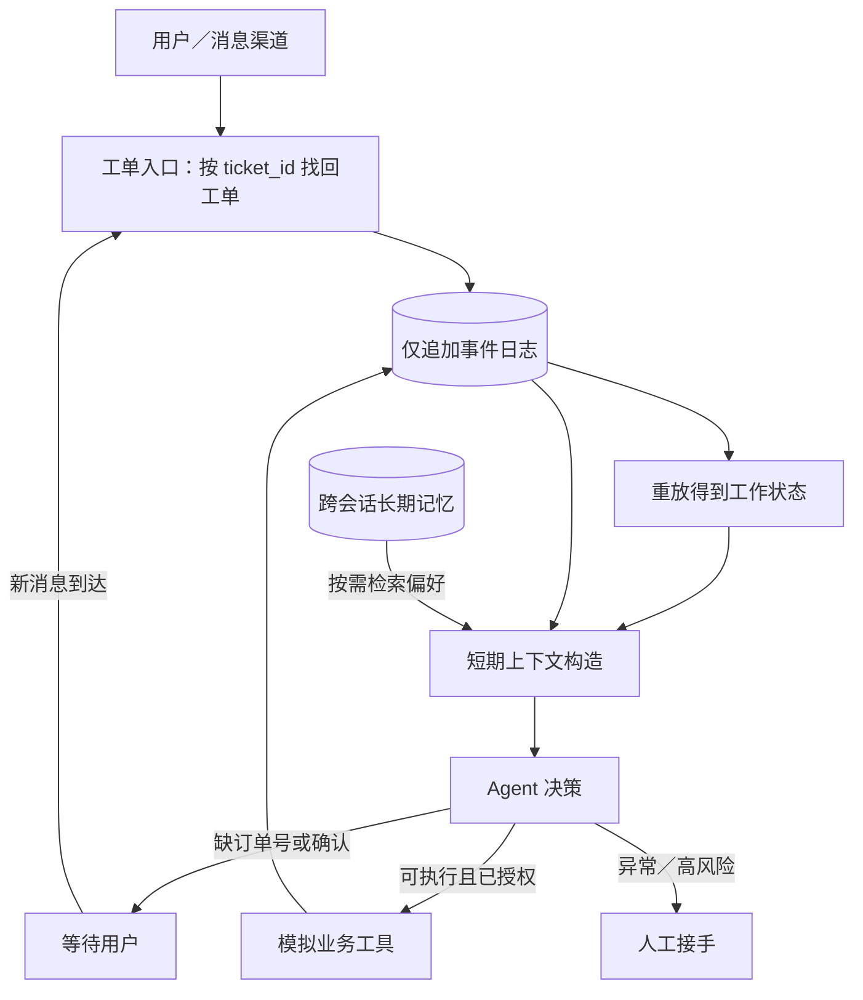

# 第一章：Agent 如何持续工作——从一句退款咨询到可恢复的售后工单

> 本篇是教学实现，贯穿工单 `T-1001`、订单 `O-1001`。本地演示只使用 Python 标准库和模拟业务数据，不会连接真实支付或退款接口。它用确定性摘要说明机制；生产系统可以换成模型摘要，但必须保留同样的可核对约束。

读完本篇，你应能回答四个问题：Agent 关闭后靠什么恢复？上下文变长时哪些内容可以压缩？跨会话记忆与当前工单有什么区别？后台任务在什么地方需要人接手？

## 1. 一个会话不能等于一项工作

想象用户晚上问：“这个订单能退款吗？”客服 Agent 查到政策后，需要订单号才能报价。用户第二天补上订单号 `O-1001`，又在看到退款草稿后说“确认退款”。如果 Agent 只把状态放在一次模型对话里，进程重启、窗口压缩或渠道切换都可能让它忘掉“已经给出草稿，但尚未得到确认”这个关键边界。结果轻则重复追问，重则重复调用退款工具。

Hermes Agent 已有会话、`/compress`、跨会话记忆、定时任务和子 Agent，因此它是很好的认知起点。DeepSeek Harness 将“会话日志—模型可见历史—Agent loop”拆得更明确：`Session` 是仅追加的事件日志，模型消息从日志投影得到；压缩是可选能力，并非 Agent loop 的必需部分。[Hermes README](https://github.com/NousResearch/hermes-agent/blob/main/README.md) · [DeepSeek Harness 会话文档](https://github.com/deepseek-ai/deepseek-harness/blob/master/docs/subsystems/session.zh.md) · [压缩文档](https://github.com/deepseek-ai/deepseek-harness/blob/master/docs/subsystems/compaction.zh.md)

把“持续工作”拆成以下五层，更容易判断每个技术能做什么：

| 层 | 记录什么 | 在 `T-1001` 中的例子 | 不该替代什么 |
| --- | --- | --- | --- |
| 事件日志 | 谁在何时说了什么、工具返回什么、动作是否执行 | `order_identified`、`refund_drafted`、`confirmation_received` | 不能用一段摘要代替完整事实 |
| 工作状态 | 从事件重放得出的当前进度 | `等待用户确认退款草稿` | 不是长期用户画像 |
| 短期上下文 | 下一次请求需要让模型看到的内容 | 订单号、用户目标、待确认动作和最近回复 | 不是全部历史的永久存档 |
| 长期记忆 | 跨工单仍可能相关、可更新的偏好 | 用户偏好短信而非电话通知 | 不能成为退款授权 |
| 后台调度与交接 | 何时再次唤醒、何时请人处理 | 次日补充消息唤醒；异常订单交人工 | 不能凭旧消息自行确认交易 |

## 2. 架构：完整事实和模型视图分开



**事件日志是事实，工作状态是事实的投影，短期上下文是给模型的一份有限视图。**进程重启时，从日志重新计算工单状态；上下文超长时，压缩的是模型视图，不删除原始事件。DeepSeek Harness 的压缩实现把锁、摘要和被遮蔽范围记入日志，再通过一次模型可见消息替换旧内容。Lossless 采用另一种可学习的设计：将原文保存在 SQLite，把较老内容换成可导航摘要，必要时按 ID 或搜索取回。[DeepSeek Harness 架构](https://github.com/deepseek-ai/deepseek-harness/blob/master/docs/architecture.md) · [Lossless core](https://github.com/stainless-code/lossless/blob/main/packages/core/README.md)

下面的代码是**独立教学片段**，说明如何把事件重新投影为状态；它不是 DeepSeek Harness 或 Hermes 的原始源码。复制到 Python 3.9+ 可运行：

```python
from __future__ import annotations

from dataclasses import dataclass, replace


@dataclass(frozen=True)
class TicketState:
    ticket_id: str
    order_id: str | None = None
    status: str = "need_order_id"
    pending_action: str | None = None
    confirmed: bool = False


def replay(events: list[dict]) -> TicketState:
    state = TicketState(ticket_id="T-1001")
    for event in events:
        kind = event["kind"]
        if kind == "order_identified":
            state = replace(state, order_id=event["order_id"], status="ready_to_quote")
        elif kind == "refund_drafted":
            state = replace(state, pending_action="refund", status="waiting_confirmation")
        elif kind == "confirmation_received" and state.pending_action == "refund":
            state = replace(state, confirmed=True, status="ready_to_execute")
        elif kind == "refund_executed" and state.confirmed:
            state = replace(state, pending_action=None, status="completed")
    return state


history = [
    {"kind": "order_identified", "order_id": "O-1001"},
    {"kind": "refund_drafted"},
]
assert replay(history).status == "waiting_confirmation"
assert replay(history + [{"kind": "confirmation_received"}]).status == "ready_to_execute"
```

`replay` 不读取进程内旧对象，所以进程关闭再启动也能得到相同状态。代码只示范状态投影；真正执行工具时还需要**唯一业务操作 ID**和已执行记录，以防工具成功后进程恰好崩溃，恢复时再扣一次款或再退一次钱。

## 3. 快速体验：运行本仓库示例

在仓库根目录运行：

```bash
python examples/demo_continuity.py
```

示例先将消息、工具调用和退款草稿写入 SQLite，再构造模型可见的短期视图：摘要包含工单号、订单号、用户的退款意图、`waiting_confirmation` 状态和待确认草稿 ID，最近消息只带两条。随后关闭 Agent 实例，用同一数据库创建新实例并重放工单；它恢复为**等待确认**，订单仍是 `paid`。跨会话读取到的“偏好短信通知”带有来源工单 `T-0900`，不会触发退款。只有用户随后明确回复“确认退款”，示例才执行并核验退款。

读代码时，先看 `src/commerce_lab/storage.py` 中的 `LabStore.append_event()`，再看 `src/commerce_lab/agent.py` 中的 `CommerceAgent.ticket_state()` 如何重放事件。接着看 `CommerceAgent.context_view()` 如何构造给模型看的短期视图，最后看 `LabStore.recall()` 如何按客户和记忆键读取跨会话偏好。这四个调用之间的数据流比摘要算法本身更重要：摘要可以变化，事件事实、确认边界与工具幂等性不能丢。

## 4. 短期压缩与长期记忆各司其职

短期压缩处理的是**本次任务的输入预算**。对 `T-1001`，一段合格摘要至少应保留 `order_id=O-1001`、目标为退款、退款草稿待确认；聊天寒暄和重复工具输出可以省略。可以先剪枝大工具结果，再做摘要，并能回查原文。压缩后要对照原事件验证关键字段，而不是因为摘要读起来流畅就认为正确。[DeepSeek Harness 压缩文档](https://github.com/deepseek-ai/deepseek-harness/blob/master/docs/subsystems/compaction.zh.md) · [Lossless core](https://github.com/stainless-code/lossless/blob/main/packages/core/README.md)

长期记忆处理的是**跨任务复用**。Mem0 的开源实现把事实写入和检索独立为记忆层；agent-memory 则以 Markdown 为真相源、SQLite 为索引，先返回路径和短摘要，再按需深读。两者都提示我们：新工单不该把所有旧对话复制进上下文，应按当前问题检索相关、带来源的内容。DeepSeek Harness 的第三方记忆 MCP 接入默认关闭，它负责接工具，记忆库的数据模型和迁移仍由外部服务负责。[Mem0 README](https://github.com/mem0ai/mem0) · [agent-memory README](https://github.com/tigerless-labs/agent-memory) · [DSH 记忆接入文档](https://github.com/deepseek-ai/deepseek-harness/blob/master/docs/user/guide/mcp-memory.zh.md)

**业务边界：**“用户喜欢短信通知”可以改变通知渠道；“用户上次同意过退款”不能代替本次 `T-1001` 的明确确认。长期记忆也可能过期，例如用户换了手机号，需记录来源与时间并允许更正。

源码级的压缩、记忆捕获、写入与召回流程，以及关键代码和提示词原文，见文末“附录 A”。

## 5. 从会话恢复走向后台工作

持续工作还包括“什么时候再醒来”。本地演示是在新消息到达后再次调用 `CommerceAgent.handle()`，用同一个 `ticket_id` 找回原工单；自动唤醒与后台调度属于进一步的目标架构。实际产品还可能接收订单状态变化、物流事件或客服排班。DSH Super-Agent Prototype 展示了更完整的形态：GitHub/飞书事件进入 Source，经授权判断建立 Ticket，再交给独立 Executor Session；工作中、等待用户、等待审核是不同状态。其 README 明确称它为**研究原型，并非正式 DeepSeek 产品**，业务系统应借鉴其工作项和人工交接思路，而不是把研究代码直接当生产实现。[项目 README](https://github.com/deepseek-ai/dsh-superagent-prototype) · [领域模型](https://github.com/deepseek-ai/dsh-superagent-prototype/blob/main/docs/001-domain.md) · [执行与恢复](https://github.com/deepseek-ai/dsh-superagent-prototype/blob/main/docs/003-execution.md)

| 失败场景 | 只靠长对话会怎样 | 本篇设计如何处理 |
| --- | --- | --- |
| 进程在等待确认时重启 | 可能忘掉草稿或把等待误判为完成 | 从事件重放，恢复 `waiting_confirmation` |
| 工具成功后、记录结果前崩溃 | 恢复后可能重复退款 | 用唯一操作 ID 向业务工具查询或幂等执行；结果写回事件日志 |
| 摘要漏掉“待确认” | Agent 可能越权执行 | 关键状态由事件投影，不从自由文本摘要推断授权 |
| 旧偏好与本次消息冲突 | 用过期渠道联系用户 | 本次明确指示优先，并更新有来源的长期记忆 |
| 后台任务遇到规则外情况 | 继续猜测并执行 | 暂停到人工审核，记录原因和待办 |

## 6. 垂类业务怎么用

电商售后并不需要一个“永不关闭的聊天窗口”。它需要一个可以恢复的**工单状态机**、可审计事件、按需注入的记忆和明确的交易确认。相同架构可以用于旅游预订草稿（日期与价格变化后重新确认）、企业采购审批（审批链与预算状态持久化）、保险理赔材料补齐（缺件等待与多渠道跟进）。变化的是业务状态和授权规则，持续工作所需的记录、恢复与交接机制保持相同。

## 7. 练习

1. 从 `context_view()` 的摘要中删除 `pending_refund_draft`，但保留原始事件。运行示例并解释为什么 Agent 仍应从事件投影恢复“待确认”。
2. 暂时注释示例中的 `restarted.handle(..., "确认退款")` 及后续输出，再运行示例。在关闭新实例前断言 `restarted.store.order("O-1001", "C-17")["status"] == "paid"` 和 `restarted.store.refund_count("O-1001") == 0`。
3. 向日志重复注入同一个工具完成事件。给事件和业务操作加入唯一 ID，使重放仍得到一次完成结果。
4. 把长期记忆的短信偏好改为“仅邮件”，再发出本次消息“请电话联系”。说明本次明确指示和旧偏好的优先级。

下一篇将处理这张图里的“Agent 决策”：如何理解用户说的退款诉求、发现缺失条件、澄清、选工具，并以真实业务状态作为完成标准。

## 附录 A：从源码理解“持续工作”

以下是本章的源码精读笔记。DeepSeek Harness 固定在 `e8f7b93a344964de3dca1ace9e72b6e4d6de87cb`；Mem0 固定在 `f1791daa86d469249c9b002f62644d58a1eb96a0`，agent-memory 固定在 `0bce2bb44e9e8dd4be420ca971f8c0a323e8871b`。代码块和提示词块摘录原文，旁边解释其作用；来源链接用于核对版本，而不代替正文中的原文。

### A.1 先分清五种“保存”

| 对象 | 保存什么 | 何时使用 | 是否直接等于用户长期记忆 |
| --- | --- | --- | --- |
| `Session` 事件日志 | 原始消息、工具调用与结果、状态事件、压缩事件 | 审计与恢复 | 否 |
| `surface` | 从日志投影出的当前模型可见消息序列 | 构造下一次模型请求 | 否 |
| 压缩检查点 | 旧 `surface` 一段历史的可继续工作摘要 | 缩短本次会话的输入 | 否 |
| 业务工作状态 | 从业务事件重放出的当前工单进度与授权边界 | 判断下一步能否执行 | 否 |
| 长期记忆 | 可跨任务复用、可检索和更正的事实与偏好 | 在未来任务中按需召回 | 是 |

DeepSeek Harness 的会话文档原文：“`Session` 是一份由类型化 `SessionEvent` 组成的**仅追加日志**，是 agent（智能体）完整交互历史的唯一真源。LLM（大语言模型）消息历史从日志*派生*而来，从不单独存储。”来源：[会话文档](https://github.com/deepseek-ai/deepseek-harness/blob/e8f7b93a344964de3dca1ace9e72b6e4d6de87cb/docs/subsystems/session.zh.md#L5-L11)。

“把完整 `Session` 日志投影成模型可见的 `surface`”可以具体理解为：日志保留所有事件；投影器只挑产生模型消息的事件，并按照 `surfaceOp` 的插入、替换关系形成当前可见顺序。例如，日志里仍保留旧工具结果和压缩审计事件，下一次请求的 `surface` 却可能只看到一条检查点和最近消息。`request/header`、`compaction/start` 等事件只用于重建与审计，不直接变成模型消息。源码文档列出的消息事件包括 `system/message`、`developer/message`、`user/message`、`assistant/message`、`tool/result`。[Surface 类型](https://github.com/deepseek-ai/deepseek-harness/blob/e8f7b93a344964de3dca1ace9e72b6e4d6de87cb/docs/subsystems/session.zh.md#surface-types)。

### A.2 压缩什么：选中的旧模型视图，不是删掉完整日志

DeepSeek Harness 默认后端先选择较旧且工具调用与结果配对完整的一段 `surface`，保留近期尾部，再以检查点替换该段。系统提示词所在的第 0 个 surface 节点不在压缩范围内。触发条件满足后，可先确定性修剪过大的工具结果；修剪足以降到阈值以下时，不必再请求模型摘要。一个过大的不可分单元不能被安全切开。[后端说明](https://github.com/deepseek-ai/deepseek-harness/blob/e8f7b93a344964de3dca1ace9e72b6e4d6de87cb/packages/compaction/compaction-basic/README.zh.md#理解实现)。

真正改变模型视图的是一条新的 `user/message`，其操作是 `replace`。下面是提交阶段的**原始代码**：

```ts
const summaryEvent = session.append('compaction/summary', {
  compactionId: startEvent.data.compactionId,
  ...startEvent.data.sourceCommandId === undefined
    ? {}
    : { sourceCommandId: startEvent.data.sourceCommandId },
  summary,
  ...callRecord,
  shadowedRange: { start, end },
  shadowedSeqs: [...shadowedSeqs],
  shadowedTokenCount,
  provider,
  model,
  ...maxTokens === undefined ? {} : { maxTokens },
  ...usage === undefined ? {} : { usage },
})
session.append('user/message', checkpointMessage, {
  surfaceOp: { op: 'replace', startSeq: start, endSeq: end },
  sourceEventSeqs: [startEvent.seq, summaryEvent.seq, ...shadowedSeqs],
})
```

来源：[region.ts 提交代码](https://github.com/deepseek-ai/deepseek-harness/blob/e8f7b93a344964de3dca1ace9e72b6e4d6de87cb/packages/compaction/compaction-basic/src/region.ts#L491-L510)。`compaction/summary` 记录摘要、被遮蔽的范围、token 估算和模型信息；新的 `user/message` 才替换旧 surface。旧事件仍在仅追加日志中，因此“模型暂时看不到”不等于“原始事实已删除”。

### A.3 什么时候压缩：自动压力、溢出恢复、手动请求

默认后端的阈值按上下文窗口 `W`、输出预留 `O`、余量 `B` 计算：`floor(min(W × 0.8, W − O − B))`，默认 `B = 65,536` tokens；近期逐字保留预算为 `W − O` 的 16%。小窗口模型需要调低余量或单独配置策略。来源：[配置与公式](https://github.com/deepseek-ai/deepseek-harness/blob/e8f7b93a344964de3dca1ace9e72b6e4d6de87cb/packages/compaction/compaction-basic/README.zh.md#调整压缩开始的时机)。

三个入口分别是：

1. **自动压力**：请求前测量当前路由的输入预算，超过阈值时先尝试工具结果剪枝，再摘要最旧的安全范围。
2. **已确认上下文溢出**：提供方返回上下文窗口错误后，尝试更激进的平衡头部缩减；成功改变 surface 后才重试请求。
3. **手动 `/compact`**：即使还未达到压力阈值，也可在空闲会话压缩有用的旧范围；没有安全且有收益的范围则返回空结果。

压缩服务提供的实际接口如下：

```ts
type CompactionTrigger = 'pressure' | 'context-overflow'
```

```ts
abstract compactIfNeeded( agent: CompactionAgentContext, trigger: CompactionTrigger, signal: AbortSignal, ): Promise<CompactionResult | null>
abstract compactNow( agent: ManualCompactAgentContext, signal: AbortSignal, sourceCommandId?: CommandId, ): Promise<CompactionResult | null>
abstract compactRegion( start: SessionSeq, end: SessionSeq, agent: CompactionAgentContext, signal?: AbortSignal, ): Promise<CompactionResult>
```

来源：[压缩服务接口](https://github.com/deepseek-ai/deepseek-harness/blob/e8f7b93a344964de3dca1ace9e72b6e4d6de87cb/docs/subsystems/compaction.zh.md#服务)。因此自动与手动的区别主要是**何时选择压缩范围**；二者都走持久化检查点机制。用户指定的区域还必须落在当前 surface 内，且两端不能切断工具调用与结果配对。[范围校验代码](https://github.com/deepseek-ai/deepseek-harness/blob/e8f7b93a344964de3dca1ace9e72b6e4d6de87cb/packages/compaction/compaction-basic/src/region.ts#L336-L357)。

**什么走自动、什么走手动？**体积过大的工具返回适合先由确定性规则自动剪枝；较老的对话过程在压力触发时自动摘要；刚作出的项目决定、待用户确认的动作和下一步约束要留在检查点或业务状态中，不能仅因旧而删。手动 `/compact` 适合主动整理长会话或交接前检查，即使尚未达到阈值。稳定用户偏好若希望跨任务复用，另走长期记忆写入，不能指望短期压缩顺便完成。

### A.4 怎么压缩：模型生成“结构化检查点”

“调用模型生成结构化检查点”不是保存模型内部状态，而是给摘要模型一份明确的输出模板，让后续模型知道目标、已做工作、边界与下一步。DeepSeek Harness 默认后端把下面这段指令放在待压缩历史之后，作为最后一条 user 消息。**原始提示词的结构部分**如下：

```ts
const COMPACTION_INSTRUCTION = [
  'You are now acting as a compaction engine for this AI coding assistant. Condense the conversation ABOVE into a structured checkpoint that lets another model resume the work with no loss of essential context.',
  '',
  'Output EXACTLY the Markdown structure below: keep every section, in order. Use terse bullets, not prose paragraphs. Write "(none)" for an empty section — never drop a section.',
  '',
  '## Primary Request and Intent',
  "- [the user's original and evolving goals; quote verbatim where the exact wording matters]",
  '',
  '## Key Technical Concepts',
  '- [technologies, frameworks, patterns, and conventions in play]',
  '',
  '## Files and Code',
  '- [exact path: why it matters, key changes or snippets]',
  '',
  '## Errors and Fixes',
  '- [error: how it was resolved, plus any related user feedback]',
  '',
  '## Pending Jobs',
  '- [explicitly requested work not yet completed]',
  '',
  '## Current Work',
  '- [precisely what was in progress at this checkpoint]',
  '',
  '## Next Step',
  '- [the single next action, directly in line with the most recent request, or "(none)"]',
  '',
  '## Critical Context',
  '- [decisions and their rationale, constraints, user preferences, open questions, data needed to continue]',
  '',
  'Rules:',
  '- Write concise English engineering prose. Preserve exact file paths, commands, error strings, identifiers, numeric values, function signatures, and syntax fragments.',
  '- Capture user feedback and explicit instructions faithfully, especially corrections.',
  '- Do NOT mention this summarization request or that the context was compacted.',
  '- Output only the checkpoint text: do not call any tool or take any other action.',
  `- If the conversation already contains a ${SUMMARY_OPEN_TAG} block, it is a PRIOR checkpoint. Do not copy it forward verbatim: preserve still-true facts, drop stale ones, and merge newer information into a single consolidated summary under the same structure.`,
].join('\n')
```

来源：[summarizer.ts 提示词](https://github.com/deepseek-ai/deepseek-harness/blob/e8f7b93a344964de3dca1ace9e72b6e4d6de87cb/packages/compaction/compaction-basic/src/summarizer.ts#L32-L66)。其中后续规则还要求保留准确的路径、命令、报错、标识符、数值、用户纠正；若输入中已有旧检查点，应融合仍有效的信息并丢弃过期内容，而不是原样层层复制。这与“目的—执行结果—边界条件—相关文件—下一步”是一类设计：字段服务于**恢复工作**，并非通用的用户画像。

**结构是否固定？**对 `dsh-compaction-basic` 这个默认后端，以上 Markdown 标题和顺序是提示词里写死的。压缩能力接口本身并不规定这八个标题；可换后端或覆盖摘要实现，设计自己的模板。后端 README 原文：“`summarize()` 是唯一的子类钩子。基于模板或远程摘要器的子类可以覆盖它，同时压力、保留、被引用的源事件、缩减验证与已遮蔽 token 计量仍由 token meter 负责。”来源：[后端扩展点](https://github.com/deepseek-ai/deepseek-harness/blob/e8f7b93a344964de3dca1ace9e72b6e4d6de87cb/packages/compaction/compaction-basic/README.zh.md#理解实现)。

### A.5 怎么判断压缩结果“有用”

源码至少做两类**机械检查**：范围安全，以及摘要确实缩短下一次请求。缩减检查的原始代码是：

```ts
const framedSummaryTokenCount = dependencies.meter.estimateMessage(checkpointMessage)
if (framedSummaryTokenCount >= prepared.shadowedRouteTokenCount) {
  throw new Error(
    `summary is not smaller than the shadowed content (${framedSummaryTokenCount} estimated framed tokens >= ${prepared.shadowedRouteTokenCount})`,
  )
}
```

来源：[region.ts 缩减验证](https://github.com/deepseek-ai/deepseek-harness/blob/e8f7b93a344964de3dca1ace9e72b6e4d6de87cb/packages/compaction/compaction-basic/src/region.ts#L410-L422)。源码还会拒绝空摘要、图片输出和达到输出上限而截断的摘要。[summarizer.ts 结果处理](https://github.com/deepseek-ai/deepseek-harness/blob/e8f7b93a344964de3dca1ace9e72b6e4d6de87cb/packages/compaction/compaction-basic/src/summarizer.ts#L163-L180) · [失败条件](https://github.com/deepseek-ai/deepseek-harness/blob/e8f7b93a344964de3dca1ace9e72b6e4d6de87cb/packages/compaction/compaction-basic/src/summarizer.ts#L196-L222)。

但“更短”不等于“仍可完成工作”。对退款工单 `T-1001`，应另做应用层检查：压缩前后是否都能取回 `O-1001`、当前目标、草稿 ID、`waiting_confirmation`、确认仍未发生，以及下一步该等待谁。再用压缩后的上下文做一次继续执行的回放：若 Agent 误以为可以退款，检查点就不合格。**授权状态最终由业务事件投影判定**，不能只信自由文本摘要。

### A.6 长期记忆从哪里来：先区分“来源”和“触发时机”

一条偏好可以来自**当前会话的当前消息**，也可以来自同一会话的较早消息或过去会话。来源是消息及事件；“会话结束后处理”“每轮处理”“定期扫增量”是不同触发策略。压缩阈值只决定短期模型视图何时缩减，不决定一条偏好有没有资格进入长期记忆。

按角色看输入时，`system` 通常是应用给 Agent 的行为指令，不能直接冒充“用户偏好”；`user` 正文是用户陈述与请求；`assistant` 正文可能包含与用户达成的方案或建议；工具结果和业务事件有自己的可信来源与时效。用户在一次提问里顺带说“以后默认用中文解释代码”，即使当前会话很短、尚未压缩，也可以被记忆捕获流程处理。

| 系统 | 捕获/写入入口 | 取同一会话消息吗 | 谁决定真正写入 |
| --- | --- | --- | --- |
| Mem0 Python OSS | 宿主应用显式调用 `Memory.add(messages, ...)` | 可以；取本次传入消息，另读此前 `add()` 保存的同范围近期消息 | 提取模型给候选，SDK 去重并写向量库 |
| agent-memory | 宿主发出 `Stop`、`SessionEnd`、`PreCompact` 等事件；也可手动记录 | 可以；从当前宿主转录取 watermark 之后的增量 | 后台推理器提议，`Store` 校验并写 Markdown |
| DeepSeek Harness 记忆 MCP | 模型按工具说明与可选指令调用第三方工具 | 可以，但取决于模型是否调用及第三方服务设计 | 第三方 MCP 记忆服务 |

保存用户偏好还需要产品层判断：用户身份和项目范围、来源时间、有效期、敏感信息权限，以及与旧事实冲突时的处理方式。下面的两个仓库各实现了其中一部分，不能把“模型提取出一句话”直接视为全部校验已完成。

### A.7 Mem0：`add()` 如何从消息提取并写入

**触发。** SDK 不监听每条聊天；应用何时调用 `add()`，何时开始一次记忆捕获。`infer=False` 是另一条路径：除 `system` 外，符合格式的消息正文被直接存为原始记忆，不经过模型提取，因此更容易把临时聊天写成噪声。原始代码：

```python
def _add_to_vector_store(self, messages, metadata, filters, infer, prompt=None):
    if not infer:
        returned_memories = []
        for message_dict in messages:
            if (
                not isinstance(message_dict, dict)
                or message_dict.get("role") is None
                or message_dict.get("content") is None
            ):
                logger.warning(f"Skipping invalid message format: {message_dict}")
                continue

            if message_dict["role"] == "system":
                continue
```

来源：[Mem0 主写入路径](https://github.com/mem0ai/mem0/blob/f1791daa86d469249c9b002f62644d58a1eb96a0/mem0/memory/main.py#L880-L896)。

**来源。** `infer=True` 会取本次传入消息、同范围之前保存的最近 10 条消息和相关旧记忆。旧消息用于解代词与补上下文，旧记忆用于去重和对照；新事实须来自本次消息。原始代码：

```python
session_scope = _build_session_scope(filters)
last_messages = self.db.get_last_messages(session_scope, limit=10)
parsed_messages = parse_messages(messages)

search_filters = {k: v for k, v in filters.items() if k in ("user_id", "agent_id", "run_id") and v}
query_embedding = self.embedding_model.embed(parsed_messages, "search")
existing_results = self.vector_store.search(
    query=parsed_messages,
    vectors=query_embedding,
    top_k=10,
    filters=search_filters,
)
```

来源：[Mem0 上下文收集](https://github.com/mem0ai/mem0/blob/f1791daa86d469249c9b002f62644d58a1eb96a0/mem0/memory/main.py#L918-L936)。`parse_messages()` 把有正文的 `system`、`user`、`assistant` 拼成带角色的文本，忽略没有正文的消息及其他角色；所以接入应用应主动筛选不应成为用户记忆依据的系统文本。原始代码：

```python
if role == "system":
    response += f"system: {content}\n"
elif role == "user":
    response += f"user: {content}\n"
elif role == "assistant":
    response += f"assistant: {content}\n"
```

来源：[Mem0 消息解析](https://github.com/mem0ai/mem0/blob/f1791daa86d469249c9b002f62644d58a1eb96a0/mem0/memory/utils.py#L61-L76)。如果同一会话前几轮**从未调用过** `add()`，那些轮次也不会凭空出现在 `last_messages` 中。提示词构造器有 `Summary`、`Recently Extracted Memories` 字段，但该主调用实际只传 `existing_memories`、`new_messages`、`last_k_messages` 和可选自定义指令；不要把提示词支持的所有字段误认为当前路径都填充了。[调用点](https://github.com/mem0ai/mem0/blob/f1791daa86d469249c9b002f62644d58a1eb96a0/mem0/memory/main.py#L944-L959) · [构造器](https://github.com/mem0ai/mem0/blob/f1791daa86d469249c9b002f62644d58a1eb96a0/mem0/configs/prompts.py#L1016-L1045)。

**模型提取规则。** 默认提示词的关键原文：

```text
Your sole operation is ADD: identify every piece of memorable information and produce self-contained, contextually rich factual statements.

You extract from BOTH user and assistant messages. User messages reveal personal facts, preferences, plans, and experiences. Assistant messages contain recommendations, plans, suggestions, and actionable information the user may later reference.

Use these ONLY for deduplication and linking — do NOT extract new memories from Existing Memories. Your extractions must come exclusively from New Messages. If new information in New Messages is semantically equivalent to an Existing Memory with no meaningful new context, skip it.
```

来源：[Mem0 提取提示词](https://github.com/mem0ai/mem0/blob/f1791daa86d469249c9b002f62644d58a1eb96a0/mem0/configs/prompts.py#L468-L516)。它还特别提醒：不要让主要话题盖过顺带透露的事实；寒暄、空泛附和不提取；助手重复用户原话时不再提取一份。对“小偏好”的覆盖依赖这一语义判断，但不保证模型绝不漏掉。[细则](https://github.com/mem0ai/mem0/blob/f1791daa86d469249c9b002f62644d58a1eb96a0/mem0/configs/prompts.py#L545-L610)。

**落盘。** 模型返回 JSON 后，SDK 对候选文本做 embedding；用文本 MD5 对检索到的旧结果及本批候选做精确去重，再写向量库，并保存历史和传入消息。没有提取出记忆时，仍保存消息供后续 `add()` 使用。原始代码：

```python
mem_hash = hashlib.md5(text.encode()).hexdigest()
if mem_hash in existing_hashes or mem_hash in seen_hashes:
    logger.debug(f"Skipping duplicate memory (hash match): {text[:50]}")
    continue
seen_hashes.add(mem_hash)
```

```python
self.vector_store.insert(
    vectors=all_vectors,
    ids=all_ids,
    payloads=all_payloads,
)
```

来源：[去重与写入](https://github.com/mem0ai/mem0/blob/f1791daa86d469249c9b002f62644d58a1eb96a0/mem0/memory/main.py#L1006-L1061)。当前 Python 主路径为 **ADD-only**：新偏好与旧偏好冲突时，提示词可让模型标出关联，但此路径没有自动废止旧事实；更正和删除需走对应 API 或应用策略。提示词要求输出 `linked_memory_ids`，而此段记录构造没有把它放进记忆 payload；后续另有从文本抽取实体的关联步骤，不能把两者当成同一机制。[记录构造](https://github.com/mem0ai/mem0/blob/f1791daa86d469249c9b002f62644d58a1eb96a0/mem0/memory/main.py#L1014-L1042)。

### A.8 agent-memory：同一会话的事件、转录与蒸馏

**事件触发。** 宿主适配器把生命周期事件映射为注入、暂停或压缩前驱逐。下面是原始事件表的一部分：

```python
HOST_CODEX: {
    "SessionStart": MOMENT_INJECT,
    "Stop": MOMENT_PAUSE,
    "PreCompact": MOMENT_EVICT,
},
```

来源：[事件映射](https://github.com/tigerless-labs/agent-memory/blob/0bce2bb44e9e8dd4be420ca971f8c0a323e8871b/packages/adapters/src/agent_memory/adapters/moments.py#L14-L41)。`Stop` 可以在同一会话一轮回复结束时出现；因此“边界捕获”不等于“只读历史会话”。前提是宿主确实发出相应事件且已安装 hook。

**取增量。** hook 从事件提供的消息列表或转录文件取消息；以 Codex 适配器为例，只把 `user` 和 `assistant` 正文当作会话文本。捕获时先脱敏，再按 watermark 取未处理部分，归档脱敏后的会话证据增量。原始代码：

```python
increment = watermark.increment(session, [redaction.redact(item) for item in items])
if not increment:
    return Capture(session=session, increment=(), instruction="", archived="")
appended = store.archive.append_session(session, list(increment))
watermark.advance(session, len(items), source)
```

来源：[增量捕获](https://github.com/tigerless-labs/agent-memory/blob/0bce2bb44e9e8dd4be420ca971f8c0a323e8871b/packages/adapters/src/agent_memory/adapters/capture.py#L32-L45) · [Codex 角色筛选](https://github.com/tigerless-labs/agent-memory/blob/0bce2bb44e9e8dd4be420ca971f8c0a323e8871b/packages/adapters/src/agent_memory/adapters/transcript.py#L10-L67)。有新增内容且 `distill_on_boundary` 启用时，hook 登记后台写入任务并启动独立执行器；当前轮次不等待模型蒸馏结束。[边界处理](https://github.com/tigerless-labs/agent-memory/blob/0bce2bb44e9e8dd4be420ca971f8c0a323e8871b/packages/adapters/src/agent_memory/adapters/hook_entry.py#L162-L187) · [任务启动](https://github.com/tigerless-labs/agent-memory/blob/0bce2bb44e9e8dd4be420ca971f8c0a323e8871b/packages/adapters/src/agent_memory/adapters/hook_entry.py#L204-L236)。

**模型提出操作。** 蒸馏器先用本批消息检索相关旧记忆，形成 reconcile sheet；再把旧记忆句柄、类型表与本批对话交给推理器。原始提示词写明：

```text
Every memory you write cites the messages it comes from as a range of message numbers, for
example "3-5" or "7". When the reconcile sheet already lists the memory this conversation is
about, name it by its handle: use update when only the wording changes, supersede when the
fact itself has changed. Anything else is new.
```

来源：[蒸馏提示词](https://github.com/tigerless-labs/agent-memory/blob/0bce2bb44e9e8dd4be420ca971f8c0a323e8871b/packages/core/src/agent_memory/core/prompts.py#L221-L254)。操作为 `new`、`update`、`supersede`、`skip`：`update` 调整表述，`supersede` 代表事实已变、旧文件保留为历史。模型负责提出；`reconcile.check()` 核对操作、旧记忆句柄等；`Store.record_many()` 才真正写入。原始代码：

```python
for spec in specs:
    problems = reconcile.check(spec, sheet)
    if problems:
        leftovers.append((spec, problems))
        continue
    record_spec = reconcile.to_record_spec(spec, sheet)
    if record_spec is None:
        continue
    accepted.append(record_spec)
result = store.record_many(accepted) if accepted else BatchResult(written=[], rejected=[])
```

来源：[蒸馏写入流程](https://github.com/tigerless-labs/agent-memory/blob/0bce2bb44e9e8dd4be420ca971f8c0a323e8871b/packages/core/src/agent_memory/core/distill.py#L104-L132)。这里的来源编号可追溯，但不是通用的事实蕴含证明：未给 `provenance` 时默认当前整批消息；确定性检查只覆盖操作格式、句柄、字段和部分明显无来源内容。不能据此宣称“每条模型提取的事实都被严格证明”。[来源默认值](https://github.com/tigerless-labs/agent-memory/blob/0bce2bb44e9e8dd4be420ca971f8c0a323e8871b/packages/core/src/agent_memory/core/reconcile.py#L270-L289)。

**其他触发规则。** `pending_message_threshold`、`pending_token_threshold`、`idle_seconds` 用于判断已归档积压内容是否值得蒸馏；在本版本中由 `mem distill` 扫描时调用，不能理解成一个持续运行的后台监听器。默认边界 hook 则可直接启动蒸馏。[触发函数](https://github.com/tigerless-labs/agent-memory/blob/0bce2bb44e9e8dd4be420ca971f8c0a323e8871b/packages/core/src/agent_memory/core/triggers.py#L33-L61) · [CLI 调用处](https://github.com/tigerless-labs/agent-memory/blob/0bce2bb44e9e8dd4be420ca971f8c0a323e8871b/packages/cli/src/agent_memory/cli/main.py#L517-L551)。

### A.9 数据库存储与 Markdown 存储：看哪一份是权威记录

**Mem0** 创建可配置的向量存储保存记忆文本、向量和元数据；另以 `SQLiteManager` 保存近期消息及变更历史：

```python
self.vector_store = VectorStoreFactory.create(
    self.config.vector_store.provider, self.config.vector_store.config
)
self.llm = LlmFactory.create(self.config.llm.provider, self.config.llm.config)
self.db = SQLiteManager(self.config.history_db_path)
```

来源：[Mem0 初始化](https://github.com/mem0ai/mem0/blob/f1791daa86d469249c9b002f62644d58a1eb96a0/mem0/memory/main.py#L488-L501)。

**agent-memory** 一条记忆是一份含 frontmatter 与正文的 Markdown 文件；SQLite FTS5 与可选向量索引是可从 Markdown 重建的投影。用户特别问到的“Markdown 落盘”，实际原始代码在 `_persist()` 中，直接贴在这里：

```python
snapshots = {path: path.read_bytes() if path.exists() else None for path in changed_paths}
try:
    payload = candidate.to_text().encode("utf-8")
    self._replace_file(target, payload)
    if moved_from is not None and moved_from != target:
        moved_from.unlink(missing_ok=True)
    if predecessor is not None and predecessor.path is not None:
        self._replace_file(predecessor.path, predecessor.to_text().encode("utf-8"))
except Exception:
    self._restore_files(snapshots)
    raise
```

来源：[store.py 的 `_persist()`](https://github.com/tigerless-labs/agent-memory/blob/0bce2bb44e9e8dd4be420ca971f8c0a323e8871b/packages/core/src/agent_memory/core/store.py#L284-L304)。`candidate.to_text()` 将字段与正文序列化为 Markdown；`_replace_file()` 写目标文件；若中途失败则恢复快照。更正事实时可另写 successor 并让旧文件失效，而不是抹去历史。`MEMORY.md` 是有限的根索引，不是全部记忆正文。[记录格式](https://github.com/tigerless-labs/agent-memory/blob/0bce2bb44e9e8dd4be420ca971f8c0a323e8871b/packages/core/src/agent_memory/core/record.py#L37-L72) · [Store 布局](https://github.com/tigerless-labs/agent-memory/blob/0bce2bb44e9e8dd4be420ca971f8c0a323e8871b/README.md#L78-L101)。

### A.10 什么时候读：注入、主动检索与本轮上下文

Mem0 的 `search(query, filters=...)` 由应用在组装回答上下文时显式调用；要求至少给出 `user_id`、`agent_id`、`run_id` 中的一种范围过滤。它不会自动监听“用户问到了旧偏好”。[检索入口](https://github.com/mem0ai/mem0/blob/f1791daa86d469249c9b002f62644d58a1eb96a0/mem0/memory/main.py#L1393-L1525)。

agent-memory 在 `SessionStart` 注入 `MEMORY.md` 的有限开头；这是固定索引，不按当前问题检索。原始代码：

```python
data = store.layout.memory_index.read_bytes()
budget = store.config.recall.injection_budget_bytes
if len(data) <= budget:
    return data.decode("utf-8")
cut = data.rfind(NEWLINE, 0, budget)
return data[: cut if cut > 0 else budget].decode("utf-8", errors="ignore")
```

来源：[会话开始注入](https://github.com/tigerless-labs/agent-memory/blob/0bce2bb44e9e8dd4be420ca971f8c0a323e8871b/packages/core/src/agent_memory/core/injection.py#L13-L28)。遇到具体任务时，技能指令建议：

```bash
mem context "<what you are about to do>"
mem recall "<query>" --json
mem read <name> --level outline
mem read <name>
```

来源：[agent-memory 的读取指令](https://github.com/tigerless-labs/agent-memory/blob/0bce2bb44e9e8dd4be420ca971f8c0a323e8871b/skills/agent-memory/SKILL.md#L17-L39)。`recall` 先给短摘要、路径、锚点和分数；`context` 在同一排序下额外展开少量靠前结果。新偏好若已在同一会话完成蒸馏，可以主动检索；`SessionStart` 不会因为本轮写入而重发。若尚未写入长期记忆，当前未压缩消息仍可能在模型上下文中，但不能假设它永久可见。[context 展开代码](https://github.com/tigerless-labs/agent-memory/blob/0bce2bb44e9e8dd4be420ca971f8c0a323e8871b/packages/core/src/agent_memory/core/context.py#L37-L69)。

### A.11 Mem0 的检索：向量候选，再叠加关键词与实体信号

原始检索代码的关键顺序：

```python
query_lemmatized = lemmatize_for_bm25(query)
query_entities = extract_entities(query)
embeddings = self.embedding_model.embed(query, "search")
internal_limit = max(limit * 4, 60)
semantic_results = self.vector_store.search(
    query=query, vectors=embeddings, top_k=internal_limit, filters=filters
)
keyword_results = self.vector_store.keyword_search(
    query=query_lemmatized, top_k=internal_limit, filters=filters
)
```

来源：[Mem0 `_search_vector_store()`](https://github.com/mem0ai/mem0/blob/f1791daa86d469249c9b002f62644d58a1eb96a0/mem0/memory/main.py#L1642-L1670)。代码随后给关键词结果归一化 BM25 分、给实体关联加分，并排除过期记录。**最终候选集合从 `semantic_results` 构造**，因此只被关键词命中、完全不在向量候选中的记录不会独立进入最终排序。`score_and_rank()` 先以语义阈值过滤，再将语义分、BM25 分、实体加分合成；可选 reranker，默认关闭。[候选与排序调用](https://github.com/mem0ai/mem0/blob/f1791daa86d469249c9b002f62644d58a1eb96a0/mem0/memory/main.py#L1684-L1701) · [评分公式](https://github.com/mem0ai/mem0/blob/f1791daa86d469249c9b002f62644d58a1eb96a0/mem0/utils/scoring.py#L60-L139)。

### A.12 agent-memory 的 `recall`：查询词、BM25、融合、去重与排序

**检索词由谁给？**平时是用户或宿主 Agent 调用 `mem recall "<query>"` 时给出；CLI 原样传给 `Recall`。写入前的旧记忆对照则将本批消息连接并截取前 `reconcile_query_chars` 个字符，作为查询。读取路径**不调用 LLM 来生成关键词**。[CLI 入口](https://github.com/tigerless-labs/agent-memory/blob/0bce2bb44e9e8dd4be420ca971f8c0a323e8871b/packages/cli/src/agent_memory/cli/main.py#L451-L457) · [对照查询](https://github.com/tigerless-labs/agent-memory/blob/0bce2bb44e9e8dd4be420ca971f8c0a323e8871b/packages/core/src/agent_memory/core/reconcile.py#L97-L117)。

#### 为什么本批消息的前一段也能查旧记忆？

这里的“查询”不是必须由模型提炼出的几个关键词。`Recall.recall(query)` 接受一整段字符串；写入前的 `reconcile.build()` 直接把本批消息拼成文本，并以 `reconcile_query_chars` 截断，默认上限为 2,000 字符：

```python
text = " ".join(message.text for message in messages)[: config.write.reconcile_query_chars]
hits = (
    Recall(store).recall(text, limit=config.write.reconcile_entries, log=False) if text else []
)
```

来源：[reconcile.py](https://github.com/tigerless-labs/agent-memory/blob/0bce2bb44e9e8dd4be420ca971f8c0a323e8871b/packages/core/src/agent_memory/core/reconcile.py#L97-L105) · [默认上限](https://github.com/tigerless-labs/agent-memory/blob/0bce2bb44e9e8dd4be420ca971f8c0a323e8871b/packages/core/src/agent_memory/core/config.py#L143-L154)。

这段长字符串不会被当作一句必须完整匹配的话。检索器先分词、去掉重复词，再把词以 **OR** 连接；FTS5 在记忆摘要、正文片段和标题的索引中寻找命中，用 BM25 对候选排序。关键原始代码：

```python
def to_match_query(query: str, tokenizer: str = TOKENIZER_ASCII) -> str:
    tokens = query_tokens(query, tokenizer)
    return " OR ".join(f'"{token}"' for token in dict.fromkeys(tokens))
```

```python
statement = (
    f"SELECT name, kind, anchor, heading, bm25({surface}) AS rank FROM {surface} "
    f"WHERE {surface} MATCH ? ORDER BY rank LIMIT ?"
)
```

来源：[生成查询表达式](https://github.com/tigerless-labs/agent-memory/blob/0bce2bb44e9e8dd4be420ca971f8c0a323e8871b/packages/core/src/agent_memory/core/search_index.py#L30-L32) · [FTS5 匹配](https://github.com/tigerless-labs/agent-memory/blob/0bce2bb44e9e8dd4be420ca971f8c0a323e8871b/packages/core/src/agent_memory/core/search_index.py#L99-L139)。例如新消息提到 `ticket T-1001` 和 `SMS updates`，而旧记忆的摘要也含这些词，整段消息虽长，仍能因共享词项命中旧记忆。随后 BM25 排序，前几个结果作为旧记忆句柄放进 reconcile sheet，供模型判断是新增、改写还是取代旧事实。

`reconcile.build()` 还会把 `profile` 类型记忆的摘要单独列入 sheet 的“Who this is about”作为背景；这不等于其完整记录已经进入可更新的命中句柄列表。原始代码：

```python
profile = tuple(record.abstract for record in store.records() if record.type == TYPE_PROFILE)
```

来源：[reconcile.py](https://github.com/tigerless-labs/agent-memory/blob/0bce2bb44e9e8dd4be420ca971f8c0a323e8871b/packages/core/src/agent_memory/core/reconcile.py#L97-L117)。

**这是一种召回启发式，不保证查对。**前 2,000 字符可能没有晚些才出现的偏好；OR 查询可能被无关词冲淡；默认 `ascii` 分词不会抽出中文词。自动批次文本中的 `user:`、`assistant:` 等英文角色前缀即便被抽出，也不能代表中文语义，可能带来噪声。初次检索没找到时，蒸馏模型可调用 Write toolkit 的 `recall` 工具，以更集中的词再检索；新命中的句柄会加入 sheet：

```python
hits = Recall(self.store).recall(
    query.strip(), limit=count or self.store.config.write.reconcile_entries, log=False
)
found = tuple(
    reconcile.Handle(hit.name, hit.type, hit.status, hit.updated, hit.abstract)
    for hit in hits
)
self._extend(found)
```

来源：[toolkit.py 的补充检索](https://github.com/tigerless-labs/agent-memory/blob/0bce2bb44e9e8dd4be420ca971f8c0a323e8871b/packages/core/src/agent_memory/core/toolkit.py#L144-L159) · [句柄扩展](https://github.com/tigerless-labs/agent-memory/blob/0bce2bb44e9e8dd4be420ca971f8c0a323e8871b/packages/core/src/agent_memory/core/toolkit.py#L208-L213)。若模型没有意识到需要补查，或相关记忆始终未进入候选，仍可能误写重复或冲突的记忆。中文会话尤其应启用 `cjk` 分词，并用真实改写问题测试召回率。

默认 `ascii` 分词用正则抽取拉丁字母、数字、下划线；`cjk` 模式另外用 jieba 加入至少两个字的中文词。重复查询词会去掉，再以 `OR` 连接。原始代码：

```python
tokens = [token.lower() for token in _ASCII_TOKENS.findall(query)]
if tokenizer == TOKENIZER_CJK:
    for token in _jieba().cut(query):
        token = token.strip()
        if token and not token.isascii() and len(token) >= _MIN_CJK_QUERY_TOKEN_CHARS:
            tokens.append(token.lower())
return tokens
```

```python
tokens = query_tokens(query, tokenizer)
return " OR ".join(f'"{token}"' for token in dict.fromkeys(tokens))
```

来源：[分词](https://github.com/tigerless-labs/agent-memory/blob/0bce2bb44e9e8dd4be420ca971f8c0a323e8871b/packages/core/src/agent_memory/core/tokenization.py#L43-L59) · [FTS5 表达式](https://github.com/tigerless-labs/agent-memory/blob/0bce2bb44e9e8dd4be420ca971f8c0a323e8871b/packages/core/src/agent_memory/core/search_index.py#L30-L32)。例如 `agent memory memory` 生成 `"agent" OR "memory"`。默认纯中文查询抽不出词；以中文为主的仓库应启用 `tokenizer = "cjk"`。不同措辞没有共享字面词时，还可启用中文向量模型。[中文配置说明](https://github.com/tigerless-labs/agent-memory/blob/0bce2bb44e9e8dd4be420ca971f8c0a323e8871b/README.md#L569-L594)。

**检索单位是片段，返回单位是文件。** Markdown 被索引为摘要片段和正文片段；较长正文按标题拆。默认 SQLite FTS5 用 BM25 排出候选，默认取 `limit=8`、候选池倍数 `10`，即先取至多 80 个片段。原始查询构造代码：

```python
statement = (
    f"SELECT name, kind, anchor, heading, bm25({surface}) AS rank FROM {surface} "
    f"WHERE {surface} MATCH ? ORDER BY rank LIMIT ?"
)
```

来源：[片段生成](https://github.com/tigerless-labs/agent-memory/blob/0bce2bb44e9e8dd4be420ca971f8c0a323e8871b/packages/core/src/agent_memory/core/chunking.py#L74-L98) · [FTS5 查询代码](https://github.com/tigerless-labs/agent-memory/blob/0bce2bb44e9e8dd4be420ca971f8c0a323e8871b/packages/core/src/agent_memory/core/search_index.py#L99-L139)。默认仅查有效记忆；指定 `as_of` 才查历史表并按当时有效期过滤。[有效性代码](https://github.com/tigerless-labs/agent-memory/blob/0bce2bb44e9e8dd4be420ca971f8c0a323e8871b/packages/core/src/agent_memory/core/recall.py#L83-L159)。

**可选向量检索与融合。** 默认 `vector_enabled = False`；开启后对查询和全部已索引片段做 embedding 余弦比较，取另一组候选。这是 SQLite 保存向量、逐项计算余弦相似度的实现，不是 ANN。BM25 与向量候选通过 RRF 按名次融合，同一片段可累加两路贡献：

```python
for candidates in (lexical, dense):
    seen: set[tuple[str, str, str, str]] = set()
    for rank, candidate in enumerate(candidates, 1):
        key = identity(candidate)
        if key in seen:
            continue
        seen.add(key)
        exemplars.setdefault(key, candidate)
        scores[key] = scores.get(key, 0.0) + 1.0 / (RRF_K + rank)
```

来源：[向量实现](https://github.com/tigerless-labs/agent-memory/blob/0bce2bb44e9e8dd4be420ca971f8c0a323e8871b/packages/core/src/agent_memory/core/vector_index.py#L89-L123) · [RRF 原文](https://github.com/tigerless-labs/agent-memory/blob/0bce2bb44e9e8dd4be420ca971f8c0a323e8871b/packages/core/src/agent_memory/core/recall.py#L26-L49)。

**去重有三层。**第一层是上述查询词去重；第二层是 RRF 以 `(name, kind, anchor, heading)` 识别同一片段，在每个来源内部不重复计分、跨两路累加贡献；第三层按记忆 `name` 把同一文件命中的多个片段归成一个结果，只保留加权分最高的片段和锚点。它**不对不同 Markdown 文件做语义去重**。原始代码：

```python
best: dict[str, tuple[float, str, str]] = {}
for candidate in candidates:
    if candidate.name not in eligible:
        continue
    weighted = candidate.relevance * self._kind_weight(candidate.kind)
    current = best.get(candidate.name)
    if current is None or weighted > current[0]:
        best[candidate.name] = (weighted, candidate.anchor, candidate.heading)
```

来源：[按文件归并](https://github.com/tigerless-labs/agent-memory/blob/0bce2bb44e9e8dd4be420ca971f8c0a323e8871b/packages/core/src/agent_memory/core/recall.py#L169-L181)。

**最终排序**按 `片段相关性 × 片段类型权重 × 记忆权重 × 时间系数`；摘要片段类型权重默认 `2.0`，正文默认 `1.0`；时间系数默认每 180 天减半，最低 `0.25`。结果按分数降序，同分按记忆名排序。原始代码：

```python
recency = self._recency(str(row["updated"]), reference)
weight = float(row["weight"])
hits.append(
    Hit(
        name=name,
        path=str(self._store.root / str(row["path"])),
        abstract=str(row["abstract"]),
        anchor=anchor,
        heading=heading,
        type=str(row["type"]),
        updated=str(row["updated"]),
        status="invalid" if row["invalid_at"] else "active",
        weight=weight,
        relevance=relevance,
        recency=recency,
        score=relevance * weight * recency,
```

来源：[最终打分](https://github.com/tigerless-labs/agent-memory/blob/0bce2bb44e9e8dd4be420ca971f8c0a323e8871b/packages/core/src/agent_memory/core/recall.py#L183-L223)。访问日志记录召回，但此公式不直接使用访问次数。

### A.13 DeepSeek Harness 的记忆 MCP：桥接不等于记忆策略

DeepSeek Harness 的记忆指南说明，它负责启动或连接第三方 MCP 服务器、发现工具，并以 `mcp__<serverName>__<tool>` 暴露；不负责第三方服务的数据库、embedding、自动摘要或数据迁移。示例默认关闭。指南给出的**可选模型指令原文**是：

> 用户要求记住某事时调用记忆写入工具；历史信息可能相关时，检索记忆并使用相关结果。

来源：[记忆 MCP 指南](https://github.com/deepseek-ai/deepseek-harness/blob/e8f7b93a344964de3dca1ace9e72b6e4d6de87cb/docs/user/guide/mcp-memory.zh.md#L1-L70)。这条指令只能影响模型何时尝试调用工具；真正的捕获覆盖率、落盘格式、冲突更正和检索算法取决于接入的提供方。指南里的 MCP Reference Memory 示例用 JSONL 知识图谱和不区分大小写的子字符串匹配，不等同于 Mem0 的向量检索，也不等同于 agent-memory 的 FTS5。

### A.14 用同一会话的小偏好贯通整条链

假设用户在谈代码时顺带说：“以后默认用中文解释代码，除非我明确要求英文。”此时还远未达到压缩阈值。

1. **当前轮可见**：该句首先是本会话 `user` 消息的一部分，Agent 当前回答可直接使用。
2. **捕获覆盖**：Mem0 只有在应用将该消息交给 `add()` 时才处理；agent-memory 在宿主下一次可用边界捕获当前转录的增量；DSH MCP 只有模型主动调用提供方写入工具或提供方另设自动流程时才处理。不要把“未来某次压缩”当作记忆捕获触发器。
3. **提取与更正**：模型提取“用户默认偏好中文解释代码”并标明用户来源。若过去记忆是“默认英文”，agent-memory 适合 `supersede`；Mem0 当前 ADD-only 路径需要应用另行处理旧偏好失效。
4. **写入与核验**：检查新记忆是否真的存在、文本是否准确、用户归属是否正确、是否带来源与时间。仅仅调用过写入 API，不代表提取模型一定捕获到这条小偏好。
5. **未来读取**：新任务开始时按用户身份和任务查询；若是 agent-memory 的中文记忆，必须考虑其默认 ASCII 分词限制。召回后还要与本次明确要求比较：若本次说“请用英文”，本次指令优先。
6. **压缩后的继续工作**：会话检查点应保留当前任务所需的活跃偏好与边界；跨任务复用则依赖长期记忆。两者可以引用同一事实，但服务不同时间尺度。

对这套系统的评测也应分层：压缩测“后续工作能否正确继续、关键状态是否保留、token 是否真减少”；写入测“该捕获的偏好有无漏掉、旧偏好是否正确失效、来源是否可信”；检索测 Recall@k、误召回、过期过滤、中文改写查询、同一文件重复命中和回答是否真正使用了正确记忆。对退款、付款等动作，最终再用业务状态与授权事件验证，不能让任何摘要或长期记忆自行充当执行许可。
