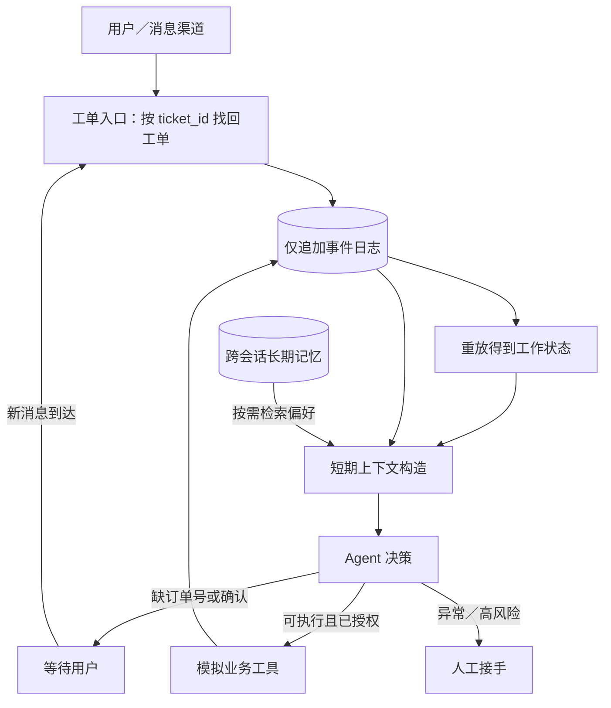

# 第一章：Agent 如何持续工作——从一句退款咨询到可恢复的售后工单

> 本篇是教学实现，贯穿工单 `T-1001`、订单 `O-1001`。本地演示只使用 Python 标准库和模拟业务数据，不会连接真实支付或退款接口。它用确定性摘要说明机制；生产系统可以换成模型摘要，但必须保留同样的可核对约束。

读完本篇，你应能回答四个问题：Agent 关闭后靠什么恢复？上下文变长时哪些内容可以压缩？跨会话记忆与当前工单有什么区别？后台任务在什么地方需要人接手？

## 1. 一个会话不能等于一项工作

想象用户晚上问：“这个订单能退款吗？”客服 Agent 查到政策后，需要订单号才能报价。用户第二天补上订单号 `O-1001`，又在看到退款草稿后说“确认退款”。如果 Agent 只把状态放在一次模型对话里，进程重启、窗口压缩或渠道切换都可能让它忘掉“已经给出草稿，但尚未得到确认”这个关键边界。结果轻则重复追问，重则重复调用退款工具。

Hermes Agent 已有会话、`/compress`、跨会话记忆、定时任务和子 Agent，因此它是很好的认知起点。DeepSeek Harness 将“会话日志—模型可见历史—Agent loop”拆得更明确：`Session` 是仅追加的事件日志，模型消息从日志投影得到；压缩是可选能力，并非 Agent loop 的必需部分。[Hermes README](https://github.com/NousResearch/hermes-agent/blob/main/README.md) · [DeepSeek Harness 会话文档](https://github.com/deepseek-ai/deepseek-harness/blob/master/docs/subsystems/session.zh.md) · [压缩文档](https://github.com/deepseek-ai/deepseek-harness/blob/master/docs/subsystems/compaction.zh.md)

把“持续工作”拆成以下五层，更容易判断每个技术能做什么：

| 层 | 记录什么 | 在 `T-1001` 中的例子 | 不该替代什么 |
| --- | --- | --- | --- |
| 事件日志 | 谁在何时说了什么、工具返回什么、动作是否执行 | `order_identified`、`refund_drafted`、`confirmation_received` | 不能用一段摘要代替完整事实 |
| 工作状态 | 从事件重放得出的当前进度 | `等待用户确认退款草稿` | 不是长期用户画像 |
| 短期上下文 | 下一次请求需要让模型看到的内容 | 订单号、用户目标、待确认动作和最近回复 | 不是全部历史的永久存档 |
| 长期记忆 | 跨工单仍可能相关、可更新的偏好 | 用户偏好短信而非电话通知 | 不能成为退款授权 |
| 后台调度与交接 | 何时再次唤醒、何时请人处理 | 次日补充消息唤醒；异常订单交人工 | 不能凭旧消息自行确认交易 |

## 2. 架构：完整事实和模型视图分开



**事件日志是事实，工作状态是事实的投影，短期上下文是给模型的一份有限视图。**进程重启时，从日志重新计算工单状态；上下文超长时，压缩的是模型视图，不删除原始事件。DeepSeek Harness 的压缩实现把锁、摘要和被遮蔽范围记入日志，再通过一次模型可见消息替换旧内容。Lossless 采用另一种可学习的设计：将原文保存在 SQLite，把较老内容换成可导航摘要，必要时按 ID 或搜索取回。[DeepSeek Harness 架构](https://github.com/deepseek-ai/deepseek-harness/blob/master/docs/architecture.md) · [Lossless core](https://github.com/stainless-code/lossless/blob/main/packages/core/README.md)

下面的代码是**独立教学片段**，说明如何把事件重新投影为状态；它不是 DeepSeek Harness 或 Hermes 的原始源码。复制到 Python 3.9+ 可运行：

```python
from __future__ import annotations

from dataclasses import dataclass, replace


@dataclass(frozen=True)
class TicketState:
    ticket_id: str
    order_id: str | None = None
    status: str = "need_order_id"
    pending_action: str | None = None
    confirmed: bool = False


def replay(events: list[dict]) -> TicketState:
    state = TicketState(ticket_id="T-1001")
    for event in events:
        kind = event["kind"]
        if kind == "order_identified":
            state = replace(state, order_id=event["order_id"], status="ready_to_quote")
        elif kind == "refund_drafted":
            state = replace(state, pending_action="refund", status="waiting_confirmation")
        elif kind == "confirmation_received" and state.pending_action == "refund":
            state = replace(state, confirmed=True, status="ready_to_execute")
        elif kind == "refund_executed" and state.confirmed:
            state = replace(state, pending_action=None, status="completed")
    return state


history = [
    {"kind": "order_identified", "order_id": "O-1001"},
    {"kind": "refund_drafted"},
]
assert replay(history).status == "waiting_confirmation"
assert replay(history + [{"kind": "confirmation_received"}]).status == "ready_to_execute"
```

`replay` 不读取进程内旧对象，所以进程关闭再启动也能得到相同状态。代码只示范状态投影；真正执行工具时还需要**唯一业务操作 ID**和已执行记录，以防工具成功后进程恰好崩溃，恢复时再扣一次款或再退一次钱。

## 3. 快速体验：运行本仓库示例

在仓库根目录运行：

```bash
python examples/demo_continuity.py
```

示例先将消息、工具调用和退款草稿写入 SQLite，再构造模型可见的短期视图：摘要包含工单号、订单号、用户的退款意图、`waiting_confirmation` 状态和待确认草稿 ID，最近消息只带两条。随后关闭 Agent 实例，用同一数据库创建新实例并重放工单；它恢复为**等待确认**，订单仍是 `paid`。跨会话读取到的“偏好短信通知”带有来源工单 `T-0900`，不会触发退款。只有用户随后明确回复“确认退款”，示例才执行并核验退款。

读代码时，先看 `src/commerce_lab/storage.py` 中的 `LabStore.append_event()`，再看 `src/commerce_lab/agent.py` 中的 `CommerceAgent.ticket_state()` 如何重放事件。接着看 `CommerceAgent.context_view()` 如何构造给模型看的短期视图，最后看 `LabStore.recall()` 如何按客户和记忆键读取跨会话偏好。这四个调用之间的数据流比摘要算法本身更重要：摘要可以变化，事件事实、确认边界与工具幂等性不能丢。

## 4. 短期压缩与长期记忆各司其职

短期压缩处理的是**本次任务的输入预算**。对 `T-1001`，一段合格摘要至少应保留 `order_id=O-1001`、目标为退款、退款草稿待确认；聊天寒暄和重复工具输出可以省略。可以先剪枝大工具结果，再做摘要，并能回查原文。压缩后要对照原事件验证关键字段，而不是因为摘要读起来流畅就认为正确。[DeepSeek Harness 压缩文档](https://github.com/deepseek-ai/deepseek-harness/blob/master/docs/subsystems/compaction.zh.md) · [Lossless core](https://github.com/stainless-code/lossless/blob/main/packages/core/README.md)

长期记忆处理的是**跨任务复用**。Mem0 的开源实现把事实写入和检索独立为记忆层；agent-memory 则以 Markdown 为真相源、SQLite 为索引，先返回路径和短摘要，再按需深读。两者都提示我们：新工单不该把所有旧对话复制进上下文，应按当前问题检索相关、带来源的内容。DeepSeek Harness 的第三方记忆 MCP 接入默认关闭，它负责接工具，记忆库的数据模型和迁移仍由外部服务负责。[Mem0 README](https://github.com/mem0ai/mem0) · [agent-memory README](https://github.com/tigerless-labs/agent-memory) · [DSH 记忆接入文档](https://github.com/deepseek-ai/deepseek-harness/blob/master/docs/user/guide/mcp-memory.zh.md)

**业务边界：**“用户喜欢短信通知”可以改变通知渠道；“用户上次同意过退款”不能代替本次 `T-1001` 的明确确认。长期记忆也可能过期，例如用户换了手机号，需记录来源与时间并允许更正。

## 5. 从会话恢复走向后台工作

持续工作还包括“什么时候再醒来”。本地演示是在新消息到达后再次调用 `CommerceAgent.handle()`，用同一个 `ticket_id` 找回原工单；自动唤醒与后台调度属于进一步的目标架构。实际产品还可能接收订单状态变化、物流事件或客服排班。DSH Super-Agent Prototype 展示了更完整的形态：GitHub/飞书事件进入 Source，经授权判断建立 Ticket，再交给独立 Executor Session；工作中、等待用户、等待审核是不同状态。其 README 明确称它为**研究原型，并非正式 DeepSeek 产品**，业务系统应借鉴其工作项和人工交接思路，而不是把研究代码直接当生产实现。[项目 README](https://github.com/deepseek-ai/dsh-superagent-prototype) · [领域模型](https://github.com/deepseek-ai/dsh-superagent-prototype/blob/main/docs/001-domain.md) · [执行与恢复](https://github.com/deepseek-ai/dsh-superagent-prototype/blob/main/docs/003-execution.md)

| 失败场景 | 只靠长对话会怎样 | 本篇设计如何处理 |
| --- | --- | --- |
| 进程在等待确认时重启 | 可能忘掉草稿或把等待误判为完成 | 从事件重放，恢复 `waiting_confirmation` |
| 工具成功后、记录结果前崩溃 | 恢复后可能重复退款 | 用唯一操作 ID 向业务工具查询或幂等执行；结果写回事件日志 |
| 摘要漏掉“待确认” | Agent 可能越权执行 | 关键状态由事件投影，不从自由文本摘要推断授权 |
| 旧偏好与本次消息冲突 | 用过期渠道联系用户 | 本次明确指示优先，并更新有来源的长期记忆 |
| 后台任务遇到规则外情况 | 继续猜测并执行 | 暂停到人工审核，记录原因和待办 |

## 6. 垂类业务怎么用

电商售后并不需要一个“永不关闭的聊天窗口”。它需要一个可以恢复的**工单状态机**、可审计事件、按需注入的记忆和明确的交易确认。相同架构可以用于旅游预订草稿（日期与价格变化后重新确认）、企业采购审批（审批链与预算状态持久化）、保险理赔材料补齐（缺件等待与多渠道跟进）。变化的是业务状态和授权规则，持续工作所需的记录、恢复与交接机制保持相同。

## 7. 练习

1. 从 `context_view()` 的摘要中删除 `pending_refund_draft`，但保留原始事件。运行示例并解释为什么 Agent 仍应从事件投影恢复“待确认”。
2. 暂时注释示例中的 `restarted.handle(..., "确认退款")` 及后续输出，再运行示例。在关闭新实例前断言 `restarted.store.order("O-1001", "C-17")["status"] == "paid"` 和 `restarted.store.refund_count("O-1001") == 0`。
3. 向日志重复注入同一个工具完成事件。给事件和业务操作加入唯一 ID，使重放仍得到一次完成结果。
4. 把长期记忆的短信偏好改为“仅邮件”，再发出本次消息“请电话联系”。说明本次明确指示和旧偏好的优先级。

下一篇将处理这张图里的“Agent 决策”：如何理解用户说的退款诉求、发现缺失条件、澄清、选工具，并以真实业务状态作为完成标准。
