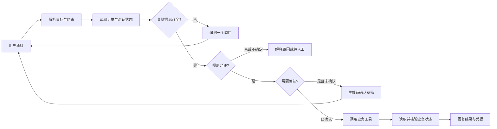
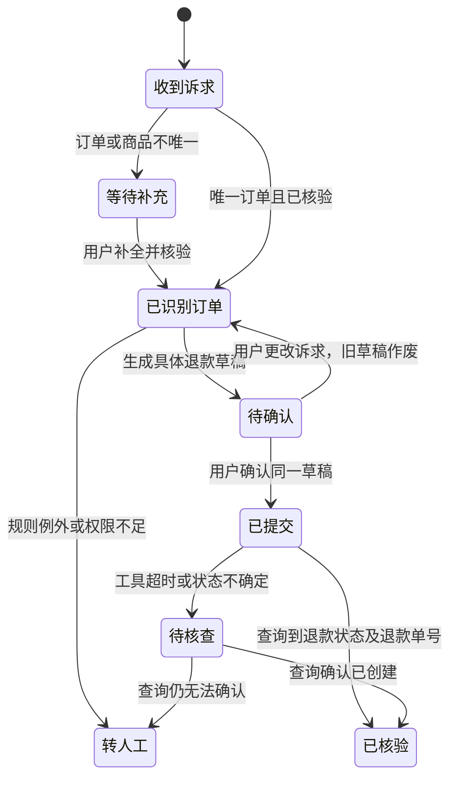

# 第二章：让用户意图落到可核验的业务结果

> 本章沿用一个贯穿三章的案例：电商售后助手。它能回答订单问题、帮助处理退款，并在信息不足或需要人工处理时停在正确的位置。代码仓库里的演示使用模拟订单，不会接入真实支付、退款或客服系统。

阅读顺序：[第一章：持续工作](01-continuous-agent.md) → **本章** → [第三章：评测反馈](03-evaluation-feedback.md)。

读完本章，你应能回答：一句含糊诉求什么时候该追问？模型识别了 `refund` 为什么还不能退款？确认应绑定什么？怎样用订单系统里的状态证明任务完成？

## 2.1 先看最终能做成什么

用户说：“上周买的耳机不合适，帮我退了。”传统意图分类器可能只返回 `refund`。售后助手还必须知道**哪笔订单、哪件商品、是否符合规则、用户是否确认提交**。如果用户买过两副耳机，直接调用退款接口就是误操作；如果助手只是回复“已为您处理”，订单仍未改变，也不是完成任务。

一个有用的产品体验应当像这样：

| 对话时刻 | 助手的动作 | 可检查的业务状态 |
|---|---|---|
| 用户提出退款，商品不唯一 | 询问订单号或提供可选订单 | 没有退款单 |
| 用户给出订单号 | 查询订单和售后规则，生成退款草稿 | 草稿待确认 |
| 用户明确确认 | 用经过校验的参数提交退款 | 模拟订单由 `paid` 变成 `refunded` |
| 工具返回后 | 再查订单状态，给出可追踪的处理结果 | 确认状态确实为 `refunded` |

这种设计的收益不只是“分类更准”。它把语言判断、业务规则和外部状态连接起来，让系统可以解释**为什么追问、为什么执行、执行是否生效**。云产品交易也存在同样问题：火山引擎的 [volcengine-sale Skill](https://github.com/volcengine/volcengine-agent-toolkit/blob/main/skills/specialized/service-support/volcengine-sale/SKILL.md) 明确将询价、购买、退订分流；同时命中询价和购买时先报价，用户确认后才进入购买。

## 2.2 从一句话到动作的六个关口



1. **解析目标**：区分“查退款政策”“估算可退金额”“发起退款”“催促已有退款”。它们可以共享“退款”关键词，却要求不同工具。
2. **提取约束**：订单号、商品、金额、退款原因、时间和用户确认状态是不同字段。不要把“上周的耳机”当成唯一订单 ID。
3. **决定是否追问**：只问会改变下一步动作的问题；AskBench 的研究重点正是[何时追问与问什么](https://github.com/jialeuuz/askbench)。
4. **按规则路由**：业务规则决定可退条件、金额和是否需要人工，不交给模型凭空猜测。SAGE-Bench 把[意图、流程路径和动作正确性分开评](https://github.com/lingshi6565/SAGE-Bench)。
5. **执行前确认**：读取信息、生成草稿与真的创建退款单应有不同权限边界。确认应绑定具体草稿，不能把早先的“好的”误认作本次授权。
6. **执行后核验**：工具返回成功码不等于业务目标已实现；需要用独立查询确认订单状态。真实业务还应返回可追踪的退款单号；若结果不确定，应标记待核查，不重复提交。

多轮对话中，用户的目标可能修改：“不用退整单，只退耳机。”生产系统此时应更新当前意图与约束，使旧草稿失效。EComAgentBench 将购物需求分散在[初始问题、用户画像和后续澄清](https://github.com/Morizeyao/EComAgentBench_)中，提醒我们不能只看第一句话。本仓库已将“只退耳机”识别为 `partial_refund` 并转人工；商品级退款和金额调整仍是后面的扩展练习。

## 2.3 用状态机防止越级执行



这张状态机描述完整方案；仓库演示实现了订单级的主要路径。完整方案有三个重要性质：

- `等待补充` 和 `待确认` **不能调用退款提交工具**。
- 工具超时后先查询状态，不能盲目重试；提交时还应传入同一业务操作的幂等键。
- 当用户改变订单、商品或金额，原确认立即失效，必须重新展示草稿。

腾讯云 IM Desk 的[官方配置文档](https://cloud.tencent.com.cn/document/product/269/108365)提供“转人工意图识别”功能，说明转人工本身也是一条业务路径。这是产品能力说明，并非开放的客服评测数据或效果证明。

## 2.4 快速体验：离线售后演示

在仓库根目录运行：

```bash
python examples/demo_intent.py
```

演示有固定的三轮对话：

1. “这单想退，能退多少钱”缺订单号，助手只澄清，不操作订单。
2. “订单 O-1001，帮我退款”进入工单 `T-1001` 的待确认状态，给出金额；订单仍为 `paid`。
3. “确认退款”才调用模拟工具，并再次查询订单，核实状态为 `refunded`。

本地输出使用固定的订单 `O-1001` 和客服工单 `T-1001`，并展示订单状态；它没有新生成退款单号，也不涉及真实支付系统。

阅读 `src/commerce_lab/` 时按“**解析输入 → 决策 → 工具调用 → 状态核验**”四段找对应函数。不要先纠结模型提示词。大模型可以替换解析器，但即使模型输出了结构化 JSON，规则校验、确认和核验仍需由业务代码负责。

先区分**演示已实现的范围**和**进阶设计**。`src/commerce_lab/intent.py` 中的 `IntentResult(label, order_id)` 只识别当前动作与订单号。`src/commerce_lab/agent.py` 在服务端工单状态中保存整单退款草稿；收到“确认退款”后，它读取当前草稿，核对订单版本与金额，使用草稿 ID 作为幂等键提交，再独立查询订单状态。对于“只退耳机”，`RuleRecognizer.recognize()` 返回 `partial_refund`，`CommerceAgent.handle()` 请求人工处理，不执行商品级退款或金额调整。演示尚未处理用户口头修改金额并自动使旧草稿失效。下面的 `IntentFrame`、`RefundDraft` 与状态机属于可继续实现的设计，不是对当前演示代码的逐行复述。

一个精简的数据契约如下。它不是让模型直接执行工具，而是让模型提出一个**待检验的意图帧**。`explicit_confirmation` 来自当前用户轮次的明确确认或界面确认事件；`active_draft` 来自服务端会话状态，不能由模型编造：

```python
from __future__ import annotations

from dataclasses import dataclass

@dataclass(frozen=True)
class IntentFrame:
    action: str               # inquire / request_refund / confirm_refund / handoff
    order_id: str | None
    item_id: str | None
    reason: str | None


@dataclass(frozen=True)
class RefundDraft:
    order_id: str
    item_id: str
    amount: int
    revision: int


def next_step(
    frame: IntentFrame,
    matching_orders: dict[str, list[str]],
    active_draft: RefundDraft | None,
    current_revision: int,
    explicit_confirmation: bool,
) -> str:
    if frame.action == "handoff":
        return "handoff"
    if frame.action == "inquire":
        return "read_only_answer"
    if frame.action == "confirm_refund":
        if not explicit_confirmation or active_draft is None:
            return "ask_for_current_draft_confirmation"
        if frame.order_id is not None and frame.order_id != active_draft.order_id:
            return "rebuild_draft"
        if frame.item_id is not None and frame.item_id != active_draft.item_id:
            return "rebuild_draft"
        if active_draft.revision != current_revision:
            return "rebuild_draft"
        return "submit_and_verify"
    if frame.action != "request_refund":
        return "clarify_intent"
    if frame.order_id is None or frame.order_id not in matching_orders:
        return "clarify_order"
    if frame.item_id is None and len(matching_orders[frame.order_id]) > 1:
        return "clarify_item"
    return "quote_and_create_draft"
```

这里有意让确认走单独分支：**模型说“用户已确认”并不意味着可以直接调用退款工具**。完整实现还须比较当前草稿对应的订单、商品、金额和版本，提交后再检查退款是否已生效。这段代码只展示扩展版决策门禁；仓库当前的订单级演示以 `examples/demo_intent.py` 和 `src/commerce_lab/` 为准。

## 2.5 怎么证明它真的理解了意图

只统计“refund 分类准确率”会漏掉最贵的错误。建议把测试用例写成对话及预期业务状态，分层记录：

| 层 | 要检查什么 | 典型失败 |
|---|---|---|
| 意图 | 用户此轮究竟要问、草拟、提交还是转人工 | 把咨询误判为提交 |
| 澄清 | 信息缺失时是否追问关键点，信息完整时是否少问 | 多订单却不追问；反复问已知订单号 |
| 约束 | 商品、预算、否定条件和多轮修改是否保留 | 用户说“只退耳机”却退了整单 |
| 路由与参数 | 工具名称、订单 ID、商品 ID、金额是否正确 | 选对退款工具却传错订单 |
| 权限与确认 | 写操作是否得到针对当前草稿的确认 | 把旧确认用于新金额 |
| 最终状态 | 订单系统里退款是否生效、是否重复 | 回复“已退款”但后台无记录 |
| 体验 | 转人工时机、轮数、时延和成本 | 明知无权限仍让用户反复描述 |

[ShoppingComp](https://github.com/ByteDance-BandAI/ShoppingComp) 将商品正确性、细约束、报告依据和安全条件拆开评分；[EComAgentBench](https://github.com/Morizeyao/EComAgentBench_) 还能按约束来源和意图类别切分结果。这些是研究用的可复现评测设计，不等于企业线上转化率。下一章会把类似的分层评测接到本章的售后助手上，让失败用例推动路由策略更新。

## 2.6 迁移到其他垂类业务

核心不是套用“退款”关键词，而是保留这条骨架：**目标与约束 → 查业务状态 → 澄清 → 规则 → 确认 → 写入 → 核验**。

| 场景 | 需要补齐的关键字段 | 写入动作 | 核验的最终状态 |
|---|---|---|---|
| 旅行预订 | 日期、人数、预算、护照或证件条件 | 创建待确认预订 | 草稿编号、价格和有效期 |
| 保险理赔 | 保单、事故时间、材料清单 | 提交理赔申请 | 案件编号与受理状态 |
| 企业采购 | 商品配置、数量、预算、审批人 | 创建采购申请 | 审批流及申请单状态 |

同一架构能做客服助手、销售助理或内部运营助手，但每个领域的业务规则、权限和“完成”定义都必须重新建模。

## 2.7 练习与检查点

下面是扩展练习，当前整单退款演示尚未覆盖这些场景。先补对应的业务状态与规则，再写用例验证。

1. 加一条“这台耳机多少钱？合适就帮我下单”的用例：系统应先报价，何时才允许创建订单？
2. 构造两笔同名商品订单，检查助手能否只追问一次并保持不提交。
3. 在待确认时把“退整单”改成“只退耳机”，检查旧确认是否失效。
4. 模拟提交工具超时但后台已完成退款，检查重试是否避免重复操作。

如果这些练习只检查自然语言回复，而不检查订单状态，就还没有验证“意图到业务结果”的完整链路。

## 参考项目与证据边界

- [火山引擎 volcengine-sale](https://github.com/volcengine/volcengine-agent-toolkit/blob/main/skills/specialized/service-support/volcengine-sale/SKILL.md)：公开的交易意图路由规则；本章的退款流程是教学改写，不是该 Skill 的实现。
- [AskBench](https://github.com/jialeuuz/askbench)：何时澄清与澄清点覆盖；本章只借鉴其问题设计。
- [EComAgentBench](https://github.com/Morizeyao/EComAgentBench_)：多来源隐藏购物意图与约束评分；公开任务使用合成画像。
- [ShoppingComp](https://github.com/ByteDance-BandAI/ShoppingComp)：商品推荐的约束、依据与安全评分。
- [SAGE-Bench](https://github.com/lingshi6565/SAGE-Bench)：多轮客服场景的意图、流程路径和动作评分。
- [腾讯云 IM Desk 文档](https://cloud.tencent.com.cn/document/product/269/108365)：转人工意图的产品能力说明；未提供可复现业务效果数据。
