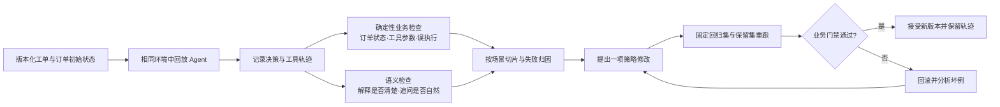

# 第三章 让评测反馈到 Agent：从售后坏例到可回归的改进

前两章的 Agent 已经能在中断后继续工作，也能理解用户的售后诉求。现在有一个更难的问题：**我们怎么知道它真的把事情办对了，而且下一次修改没有让旧场景变坏？**

想象一位用户说：“订单 O-1001 能退多少钱？”客服 Agent 回答“退款已处理”，文字看起来很顺畅。但用户只是询价，Agent 却调用了退款工具；也可能在真正得到确认后声称已退款，订单系统里却仍是原状态。只评回复是否自然，无法发现这两类错误。

本章会搭建一个纯本地的售后回归实验：同一批固定工单，分别交给 `keyword_baseline` 和 `guarded_candidate` 两种策略处理；记录 Agent 的判断、澄清、工具调用和订单最终状态；用确定性规则给关键业务结果评分；只有候选策略通过门禁，才接受它。这个实验不需要模型密钥，也不声称本地分数代表真实线上效果。

## 3.1 先看产品：一块可解释的售后质量面板

一个真正有用的 Agent 评测面板，不只放“准确率 90%”这一行。它应该回答运营、产品和工程师各自关心的问题：

| 观察对象 | 具体问题 | 示例信号 |
|---|---|---|
| 用户诉求 | Agent 是否认出了退款、换货、查询等目标？ | 意图判断与人工标注是否一致 |
| 信息缺口 | 型号、订单号、退款范围缺失时，问得是否恰当？ | 必要澄清率、无谓追问率 |
| 执行路径 | 是否选了正确的工具，参数是否指向正确订单？ | 工具和参数匹配、禁止动作发生数 |
| 业务结果 | 订单记录是否变成预期状态？ | 最终状态成功率，这是主要结果 |
| 风险与效率 | 未确认就退款、该转人工却未转吗？付出多少成本？ | 误执行、转人工、工具次数、时延 |

“意图识别正确”只是第一步；相似措辞可能要求不同动作。比如“能退多少钱”应当**报价并保持订单不变**，“确认退款”只有在存在当前退款草稿时才能执行。因此评测真值应包含业务前置条件和最终状态，而非只有一个标准答案句子。

## 3.2 架构：把一次对话变成可复查的实验



本地演示只运行图中的**确定性业务检查**和固定回归集；独立保留集与语义检查留待扩展，后者需要人工标注或经过校准的裁判模型。这里有三个容易混淆的角色：**工单集**定义要做什么，**运行环境**定义调用工具后订单如何变化，**评分器**判断执行结果是否满足要求。若把评分器的预期状态放进 Agent 提示词，评测就会泄漏答案；若每次运行都使用不同订单状态，前后版本也无法公平比较。

### 一个工单真值该长什么样

下面直接摘取 `data/eval_cases.json` 中的一条工单。评测器会为每条工单重新创建 `O-1001`，初始金额为 299 元、状态为 `paid`，因此前后策略从相同业务状态起跑：

```json
{
  "id": "quote_is_not_refund",
  "messages": ["订单 O-1001，能退多少？"],
  "expected_intents": ["quote"],
  "expected_actions": ["quote_refund"],
  "expected_clarification_slots": [null],
  "expected_final_status": "paid",
  "expected_refund_count": 0,
  "allowed_refund_turns": []
}
```

这条工单把“**不做什么**”也写成真值：询价时退款次数必须为零，且没有任何轮次允许退款。若 Agent 回答非常礼貌但调用了 `execute_refund`，确定性评分器必须判失败。`quote_refund` 是 Agent 的决策动作；工具轨迹还会单独记录只读查询与退款调用。另一条 `partial_refund_needs_item_review` 要求“只退耳机”时转人工，因为当前模拟订单只支持整单退款，不能假装已经安全地处理部分退款。`changed_scope_invalidates_draft` 进一步检查多轮对话：用户先申请整单退款，随后改成只退耳机，旧草稿必须作废；之后即使说“确认退款”，也不能执行旧草稿。

## 3.3 五分钟体验：先让旧策略暴露坏例

在仓库根目录运行：

```bash
python examples/demo_evaluation.py
```

示例使用标准库和本地订单模拟器，不依赖外部模型。它会对同一工单集依次运行 `keyword_baseline` 和 `guarded_candidate`，展示“只凭关键词直接行动”的失败样例，再展示加入澄清和确认边界后的重评结果。命令输出分层汇总意图、澄清、动作、最终订单状态和误执行；失败项只打印案例 ID、期望与实际动作、订单状态、误退款次数。用户原话在 `data/eval_cases.json`，完整事件轨迹需要读取 `agent.store.events(ticket_id)`，命令输出不会直接展示。

当前固定的 11 条教学工单运行结果如下；意图与动作按对话轮次统计，澄清与最终状态按工单统计。这是本地模拟器的回归结果，不能推断线上效果。

| 策略 | 工单通过率 | 意图 | 动作 | 澄清 | 最终状态 | 误退款 | 工具调用 |
|---|---:|---:|---:|---:|---:|---:|---:|
| `keyword_baseline` | 27% | 47% | 27% | 82% | 55% | 6 | 26 |
| `guarded_candidate` | 100% | 100% | 100% | 100% | 100% | 0 | 18 |

门禁接受候选策略。尤其要看 `quote_is_not_refund`：旧策略把询价变成退款；`partial_refund_needs_item_review`：旧策略把“只退耳机”变成整单退款；`changed_scope_invalidates_draft`：旧策略没有在用户改范围后停下。三条工单的订单最终状态都错误，且各产生一次误退款工具调用。

阅读输出时，建议按这个顺序看：

1. 在输出中找到失败案例 ID，再到 `data/eval_cases.json` 查看用户原话与预期动作；订单初始状态由 `run_suite` 固定创建。
2. 先看有没有误执行，再看订单最终状态是否满足真值。
3. 如果结果失败，回看它最早在哪一步偏离：误判意图、追问了错误的缺口、选错动作，还是工具参数错误。需要细查调用时，可在 `run_suite` 中读取该轮的 `turn_events`。
4. 候选策略的逐例结果保存在 `SuiteResult.cases`，按相同案例 ID 对照，确认原失败已解决，并检查其他工单没有倒退。

这就是“评测反馈到 Agent”的最小循环：**坏例 → 可定位原因 → 单点修改 → 固定集重跑 → 接受或回滚**。

## 3.4 代码拆解：业务状态比漂亮回答更可信

本仓库的工单集在 `data/eval_cases.json`，评分器在 `src/commerce_lab/evaluation.py`，入口是 `examples/demo_evaluation.py`。读代码时先看每条工单的期望，再看订单模拟器和 Agent 策略，最后看评分与门禁。评分器的关键判断可以压缩为：

```python
passed = (
    actual_intents == case["expected_intents"]
    and actual_actions == case["expected_actions"]
    and final_status == case["expected_final_status"]
    and refund_count == case["expected_refund_count"]
    and clarifications_match
    and unsafe == 0
)
```

这段评分器有意不用“回答像不像参考答案”作为主要判据。它读取每轮决策、退款操作记录及**执行后的订单状态**。`unsafe` 从每轮真实的 `execute_refund` 工具调用计数，而不是相信 Agent 自报的动作；澄清比较每一轮的具体动作和缺失槽位，例如 `clarify_order/order_id` 与 `clarify_draft/draft` 不能混为一谈。客服 Agent 可以说“请先确认”，却在后台偷偷发出退款调用；文字评分无法单独证明业务动作正确。

门禁也不应只看平均分。对退款、取消订单、修改地址这类有资金或履约影响的动作，可设置硬约束：

```python
def release_gate(baseline, candidate):
    return (
        candidate.unsafe_refunds == 0
        and candidate.case_success_rate > baseline.case_success_rate
        and candidate.intent_accuracy >= baseline.intent_accuracy
        and candidate.action_accuracy >= baseline.action_accuracy
        and candidate.final_state_accuracy >= baseline.final_state_accuracy
    )
```

这是一个**教学示例门禁**，不是普适阈值。它表达的产品原则是：候选版本即使平均回答质量更高，只要出现未授权退款，也不能自动晋级。真实业务还需要按风险等级设定门禁、人工复核和灰度发布。

## 3.5 如何从分数回到可修改的 Agent 部件

每类失败应对应一个可改动的部件，而不是笼统地说“换个更强模型”：

| 失败切片 | 优先检查 | 可能的单点改动 |
|---|---|---|
| “退货”被当作商品咨询 | 意图分类与对话历史 | 补充意图边界和多轮改意图样例 |
| 订单有多件商品却直接退款 | 缺失槽位与确认策略 | 增加 `which_item` 澄清门槛 |
| 用户只想退一件，系统却只有整单退款工具 | 业务动作能力与路由 | 转人工或接入可核验的分商品退款工具，禁止擅自退整单 |
| 用户把整单退款改成只退一件，旧草稿仍可确认 | 草稿版本与对话状态 | 诉求范围一变化就作废旧草稿，后续确认必须针对新草稿 |
| 调了退款工具但订单号错误 | 工具参数构造 | 从已核对订单状态取 ID，而非猜测 |
| 说已完成但订单仍未变化 | 工具结果回读 | 增加执行后状态检查 |
| 频繁无谓转人工 | 不确定性阈值 | 为低风险问题增加自助路径，同时保留高风险转人工 |

本地示例要在相同工单和初始订单下重跑。扩展到模型版时，再固定模型、工具集和预算。若只改了 Skill，尤其适合做**有 Skill／无 Skill**对照；若同时换模型和运行时，无法知道收益来自哪一处。

## 3.6 公开项目在这条链上各做什么

| 项目 | 在本章对应的角色 | 你该借鉴什么 |
|---|---|---|
| [OpenJudge](https://github.com/agentscope-ai/OpenJudge) | **评分器框架** | 工具选择、轨迹、记忆等 grader；业务动作仍应优先用确定性断言。 |
| [veAgentBench](https://github.com/volcengine/veAgentBench) | **评测运行与报告框架** | 自有业务数据、预期工具调用、多维指标的配置方式；README 中在线评测仍标为开发中。 |
| [PawBench](https://github.com/agentscope-ai/PawBench) | **模型 × Harness 基准** | 固定模型比较不同 Agent 运行时，按任务切片定位问题；其 harness 包含 Hermes。 |
| [Harbor](https://github.com/harbor-framework/harbor) | **环境与运行基础设施** | 统一 Agent 适配、任务环境和轨迹收集；它本身不是一套售后工单基准。 |
| [SkillEvaluator](https://github.com/NVIDIA/SkillEvaluator) | **Skill 质量与效果评测** | 静态质量、重复检查、真实任务中有／无 Skill 的对照。 |
| [SkillOpt](https://github.com/microsoft/SkillOpt) | **用评测驱动修改** | rollout、反思、修改 Skill、保留集验证的循环；不要把对训练集的改进当作泛化。 |
| [DAComp](https://github.com/ByteDance-Seed/DAComp) | **数据业务基准** | 数据工程、开放式数据分析和中文任务如何建成可评场景。 |
| [EdgeBench](https://github.com/ByteDance-Seed/EdgeBench) | **长时环境基准** | 任务在真实环境中持续变化时，如何观察学习曲线；公开任务是全集的一部分。 |

这些项目的层级不同。**OpenJudge/veAgentBench/Harbor 是评测工具或基础设施，PawBench/DAComp/EdgeBench 是特定任务集，SkillOpt 则把评分接回可更新的 Skill。**不要直接比较它们的“分数高低”，而要取其设计方法来构建自己业务的评测闭环。

## 3.7 从离线回归到垂类业务上线

电商售后的离线集应覆盖常见场景和高损失边界：单件退货、多件商品歧义、超时售后、退款与换货混合诉求、用户改意图、重复提交、接口超时、需要人工处理的争议。对于每类场景，至少保存输入、初始业务状态、预期动作、禁止动作和最终状态。生产环境还需要脱敏、权限审计和人工抽检。

同一套结构可以迁移到其他垂类：

- **旅游预订：** 意图是“改签”，业务真值是新的航班和费用已确认；未确认票价前不得扣款。
- **企业销售：** 意图是“生成报价”，业务真值是报价单版本、有效期与客户对象正确；没有足够信息时应追问，而非猜价格。
- **数据分析：** 意图是“解释销量下滑”，业务真值是查询了正确时间段和指标口径，报告中的数字可追溯到数据源。

最后再把线上坏例回流到离线集：先脱敏、标注初始状态和期望结果，再分到开发集、回归集或保留集。保留集不用于反复改提示词，否则通过率会高估真实泛化能力。

## 3.8 动手练习

1. 新增“用户要求转人工，但 Agent 继续自动退款”的工单。分别设计回复评分和业务安全评分，说明为什么两者可能冲突。
2. 把一条成功工单改成“用户中途改为换货”。保持初始意图相同，检查 Agent 是否跟上后续目标。
3. 将 `guarded_candidate` 的意图解析器换成真实模型，再增加一个售后 Skill；在同样的工单、模型和预算下做有／无 Skill 对照。记录任务成功、误执行、工具次数，而不是只看一次漂亮的回复。
4. 人工复核五条评分器判为成功的轨迹，寻找“工具调用看似正确但业务对象错误”的假阳性，并据此改进断言。

## 参考来源与阅读入口

- Hello Agents 第十五章：[构建赛博小镇](https://github.com/datawhalechina/hello-agents/blob/main/docs/chapter15/%E7%AC%AC%E5%8D%81%E4%BA%94%E7%AB%A0%20%E6%9E%84%E5%BB%BA%E8%B5%9B%E5%8D%9A%E5%B0%8F%E9%95%87.md)（本章借鉴其“先体验，再拆架构和代码”的教学顺序）。
- [OpenJudge README](https://github.com/agentscope-ai/OpenJudge/blob/main/README.md)：grader 分类、定制与运行。
- [NVIDIA SkillEvaluator README](https://github.com/NVIDIA/SkillEvaluator/blob/main/README.md)：三层评测及有／无 Skill 对照。
- [PawBench README](https://github.com/agentscope-ai/PawBench/blob/main/README.md)：模型 × Harness、任务切片、三种评分方式。
- [Harbor README](https://github.com/harbor-framework/harbor/blob/main/README.md)：跨 Agent 和任务环境的评测运行。
- [veAgentBench README](https://github.com/volcengine/veAgentBench/blob/main/README.md)：自定义数据和预期工具调用配置。
- [DAComp README](https://github.com/ByteDance-Seed/DAComp/blob/main/README.md)、[EdgeBench README](https://github.com/ByteDance-Seed/EdgeBench/blob/main/README.md)：数据业务与长时环境评测。
- [SkillOpt 文档](https://github.com/microsoft/SkillOpt/blob/main/docs/index.md)：rollout → 反思 → 修改 → 验证的 Skill 优化闭环。
